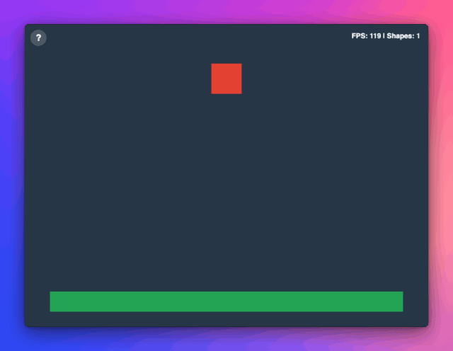

# ⚡ 2D Stacking Physics Demo: Pixi.js + Rapier.js (WASM) + Vite

An interactive, light-weight 2D physics sandbox and stacking demo built with **Pixi.js v8** for high-performance canvas rendering and **Rapier.js** for WebAssembly-powered rigid body physics.

This repository serves as a clear, beginner-friendly template and learning resource for developers looking to integrate WebAssembly physics engines with modern 2D rendering pipelines.

---

## 🚀 Live Demo

[**Play the Live Demo Here**](https://ignat-ignatov.github.io/rapier-pixi-vite-demo/)



---

## ✨ Features

- **High-Performance 2D Rendering:** Built on Pixi.js v8 for smooth, hardware-accelerated canvas graphics.
- **WASM Physics Engine:** Powered by `@dimforge/rapier2d-compat` for realistic gravity, box collisions, momentum, and friction.
- **Dynamic Object Spawning:** Click anywhere on empty background space to spawn randomized dynamic boxes.
- **Interactive Pointer Dragging:** Grab and fling physics shapes using custom pointer listener logic.
- **Automatic Spatial Cleanup (Despawning):** Off-screen boundary checks automatically destroy physical and visual bodies when they fall or get flung out of bounds to keep RAM and performance optimal.
- **Custom Pixi UI Overlay:** Built-in HUD showing real-time FPS performance, active shape counts, and an interactive instructions modal card with custom z-index depth sorting.
- **Modern Build & Deploy:** Pre-configured with **Vite** for fast HMR (Hot Module Replacement) and automated continuous deployment to **GitHub Pages via GitHub Actions**.

---

## 🛠️ Tech Stack

| Technology | Purpose |
| :--- | :--- |
| **[Vite](https://vitejs.dev/)** | Fast frontend tooling and dev server |
| **[Pixi.js v8](https://pixijs.com/)** | 2D WebGL/WebGPU rendering engine |
| **[Rapier.js 2D](https://rapier.rs/)** | Fast WebAssembly 2D physics engine |
| **[GitHub Actions](https://github.com/features/actions)** | Automated cloud build & deployment workflow |

---

## 🧠 Key Concepts & Architecture

### 1. Meter-to-Pixel Coordinate Conversion
Physics engines like Rapier calculate movement in standard real-world metric units (meters, kilograms, seconds), while visual renderers like Pixi display objects in screen pixels. 
- **Scale Factor:** $1\text{ meter} = 50\text{ pixels}$.
- Physical properties are calculated in meters, then scaled up to pixel coordinates right before rendering each frame.

### 2. Decoupled Architecture
To keep the codebase modular and readable:
- `physics.js`: Handles world initialization, rigid body creation, dynamic boxes, and ground platforms.
- `renderer.js`: Handles Pixi Application setup, stage initialization, and rectangle graphic creation.
- `input.js`: Maps pointer coordinates into physical space for interactive object dragging.
- `ui.js`: Manages screen text, HUD stats counters, backdrop overlays, and z-index sorting.
- `main.js`: Acts as the conductor—running the ticker loop, syncing physical positions to visual graphics, and handling boundary despawning.

---

## 📦 Getting Started

### Prerequisites
Make sure you have [Node.js](https://nodejs.org/) (v18 or higher recommended) installed on your machine.

### Installation

1. Clone the repository:

```bash
git clone [https://github.com/your-username/rapier-pixi-vite-demo.git](https://github.com/your-username/rapier-pixi-vite-demo.git)
cd rapier-pixi-vite-demo
```

2. Install dependencies:

```bash
npm install
```

3. Start the local development server:

```bash
npm run dev
```

4. Open your browser and navigate to http://localhost:5173.

---

## 📜 Available Scripts
- `npm run dev` — Starts the Vite development server with Hot Module Replacement.

- `npm run build` — Bundles and minifies production assets into the dist/ folder.

- `npm run preview` — Locally previews the built production output.

## 📖 In-Depth Learning Guide & Documentation
If you want to understand how every function, WASM initialization step, and loop works line-by-line, check out the GitHub Wiki / Detailed Guide included in this repo!

## 📄 License
This project is open-source and available under the UNLICENSE License. Feel free to use it as a base for your own physics puzzle games or educational experiments!

## 💡 Acknowledgements & Learning Process

This repository was created as a personal study and learning experiment to explore 2D physics integration using Pixi.js v8, Rapier.js (WASM), and Vite. 

The project architecture, step-by-step implementation, and documentation were developed through collaborative pair-programming with **Gemini 3.6 Flash**, serving as a comprehensive learning resource for developers starting out with web-based physics engines.
